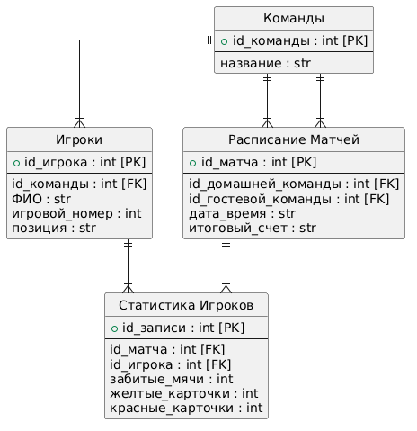

# Учёт спортивных соревнований (мини-футбол)

## Структура проекта

```text
football_system/
│
├── .vscode/                     # Настройки Visual Studio Code
│
├── docs/                        # Документация проекта
│   └── diagrams/                # Сюда сохраняем картинки схем
│   ├── diagram.puml             # Диаграмма прецедентов (PlantUML)
│   └── er_diagram.puml          # ER-диаграмма базы данных (PlantUML)
│
├── src/                         # Исходный код приложения
│   └── football_system/         # Основной пакет приложения
│       ├── database/            # Работа с базой данных
│       │   ├── __init__.py
│       │   ├── init_db.py       # Скрипт создания базы данных
│       │   ├── schema.sql       # Код для создания таблиц
│       │   └── data.sql         # Тестовые записи для проверки
│       │
│       ├── models/              # Модели предметной области
│       │   └── __init__.py
│       │
│       ├── repositories/        # Доступ к данным (SQL-запросы к таблицам)
│       │   └── __init__.py
│       │
│       ├── services/            # Бизнес-логика приложения 
│       │   └── __init__.py
│       │
│       ├── __init__.py          # Главный маркер пакета
│       ├── main.py              # Точка входа в приложение и консольное меню
│       └── football.db          # Файл самой базы данных SQLite
│
├── tests/                       # Автоматизированные тесты
│   ├── __init__.py
│   └── test_main.py             # Тестовые сценарии для проверки кода
│
├── .gitignore                   # Исключения для Git
├── LICENSE                      # Лицензия проекта
└── README.md                    # Документация проекта
```


## Описание проекта
Данный проект предназначен для автоматизации ведения футбольных турниров, управления списками команд и ведения статистики игроков, заменяя бумажные протоколы цифровой базой данных.

## Роли в системе и права доступа
*   **Пользователь (Болельщик):** Доступен режим «только чтение». Может просматривать расписание матчей, турнирную таблицу и персональную статистику игроков.
*   **Администратор:** Обладает полными правами управления. Авторизация происходит через проверку поля `role` в таблице `Users` базы данных.

## Функционал и возможности
### Админитратор
*   Регистрация новых команд в системе.
*   Управление составами команд (назначение позиций: *Вратарь, Защитник, Универсал, Столб*).
*   Формирование и редактирование расписания матчей.
*   Внесение и сохранение результатов прошедших игр.

### Пользователь
*   Просмотр актуального расписания игр.
*   Просмотр обновляемой турнирной таблицы.
*   Просмотр индивидуальной статистики игроков.

## Стек технологий
*   **Язык программирования:** Python 3.14
*   **Среда разработки:** VS Code
*   **Система контроля версий:** Git / GitHub
*   **База данных:** SQLite (встроенная реляционная БД для хранения пользователей, команд и результатов)


