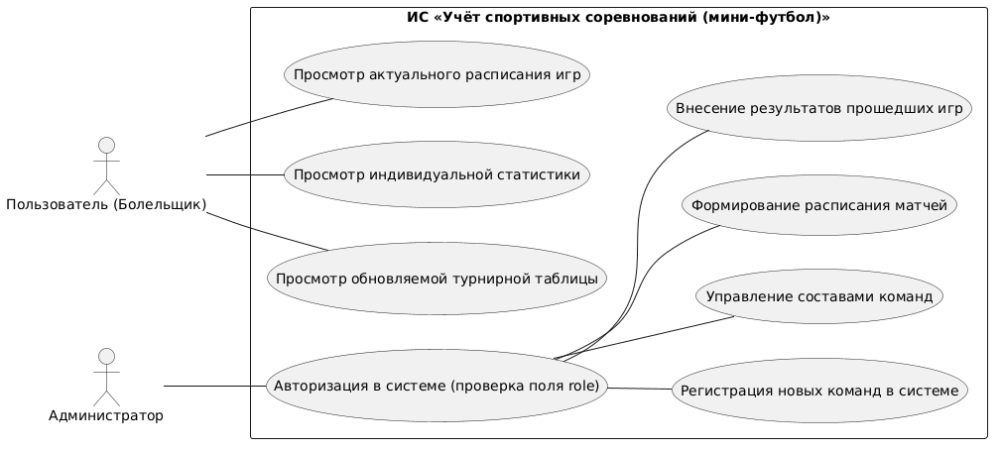

# Информационная система «Учёт спортивных соревнований (мини-футбол)»

## Структура проекта
## Структура проекта

```text
football_system/
├── .gitignore
├── LICENSE
├── README.md
├── requirements.txt
├── docs/
│   ├── diagram.png
│   └── diagram.puml
├── src/
│   └── football_system/
│       ├── __init__.py
│       └── main.py
└── tests/
    ├── __init__.py
    └── test_main.py
```

## Описание проекта
Данный проект предназначен для автоматизации ведения футбольных турниров, управления списками команд и ведения статистики игроков, заменяя бумажные протоколы цифровой базой данных.

## Роли в системе и права доступа
*   **Пользователь (Болельщик):** Доступен режим «только чтение». Может просматривать расписание матчей, турнирную таблицу и персональную статистику игроков.
*   **Администратор:** Обладает полными правами управления. Авторизация происходит через проверку поля `role` в таблице `Users` базы данных.

## Функционал и возможности
### Админитратор
*   Регистрация новых команд в системе.
*   Управление составами команд (назначение позиций: *Вратарь, Защитник, Универсал, Столб*).
*   Формирование и редактирование расписания матчей.
*   Внесение и сохранение результатов прошедших игр.

### Пользователь
*   Просмотр актуального расписания игр.
*   Просмотр обновляемой турнирной таблицы.
*   Просмотр индивидуальной статистики игроков.

## Стек технологий
*   **Язык программирования:** Python 3.14
*   **Среда разработки:** VS Code
*   **Система контроля версий:** Git / GitHub
*   **База данных:** SQLite (встроенная реляционная БД для хранения пользователей, команд и результатов)


